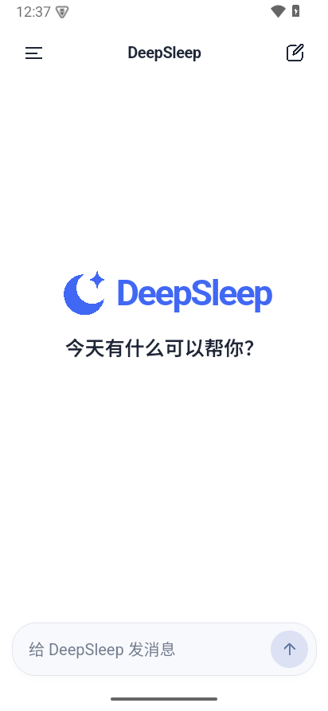
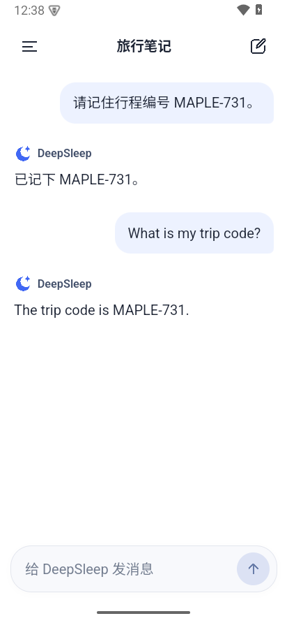

# DeepSleep

DeepSleep 是一款第三方 Android 聊天客户端。打开应用即可进入中文聊天页，使用 DeepSeek 账号授权后就能发消息，无需创建或粘贴个人 API Key。你也可以把 DeepSeek 网页版导出的对话带到手机上，在原来的上下文里继续聊。

<p>
  
  
</p>

## 安装与登录

0.3 版支持 **Android 8.0（API 26）及以上的 ARM64 设备**。APK 约 190 MiB，首次启动需要解压手机端运行环境，建议预留 1.5 GB 存储空间。

1. 下载 [DeepSleep 0.3 ARM64 安装包](https://github.com/Aleeeeeen/DeepSleep/releases/download/v0.3.0/DeepSleep-0.3-arm64.apk)，或按下文从源码构建。已安装旧版的设备可用同包名、同签名的 APK 覆盖升级，保留本机会话。
2. 打开左上角菜单，选择 **我的账号 → 登录 DeepSeek 账号**。系统浏览器会打开 DeepSeek 官方的 Harness 授权页。授权完成后返回 DeepSleep，即可使用账号可用的模型。
3. 对话使用 DeepSeek 开放平台余额。需要充值时，从 **我的账号** 进入官方收银台，确认金额并付款。返回应用后会刷新余额。

## 从网页版迁移对话

1. 在 DeepSeek 网页版导出聊天记录，将下载的原始 ZIP 保存到手机。
2. 在 DeepSleep 左侧菜单点 **导入历史**，用系统文件选择器选中 ZIP，再点 **开始导入**。
3. 在导入结果里点会话标题，直接输入下一条消息。之后也能从左侧历史列表重新打开。

导入和阅读在本机完成。发送追问时，客户端会把当前会话所需的上下文发送给模型。导入产生本地副本，后续消息保存在 DeepSleep。重复导入同一个 ZIP 会产生重复会话。卸载应用会清除本地聊天记录。

| 导入项目 | 0.3 版支持范围 |
| --- | --- |
| 文件格式 | 官方 v3 导出，包含 `manifest.json`、`chat_session_index.json` 和 `chat_sessions/` |
| 容量 | ZIP 最大 128 MiB，单个解压条目最大 32 MiB，每次最多导入最近 1,000 条会话 |
| 对话分支 | 保留导出时选中的分支，并沿该分支续聊 |
| 附件 | 导出包中有原件且格式受支持的图片可保存为附件，其他文件保留文件卡片 |

## 手机聊天与 DSH

默认聊天页支持新建会话、流式回复和停止生成。普通聊天使用纯对话模式，模型请求中不携带文件、终端等工作工具。

需要使用完整的 **DeepSeek Harness（DSH）** 工作界面时，在左侧菜单选择 **切换至 DSH**。点 DSH 顶栏的 **返回 DeepSleep** 可回到手机聊天页。两个界面共用本机的会话库。启用了 DSH 工具的高级会话可以在手机聊天页阅读，继续执行这类会话时请切换至 DSH。

## 从源码构建

DeepSleep 的实现和构建入口位于 [chat/](chat/)。以下命令在 **Windows PowerShell** 中从仓库根目录运行。

准备 JDK 21、Python 3.9+ 和 Android SDK Platform 35。设置 `JAVA_HOME` 和 `ANDROID_HOME`，并确认 `python` 在 PATH 中。另需下载上游发布附件 **`DSH-forAndroid-0.2.5-source.zip`**，其中包含固定版本的运行时和 Android 构建工具。构建脚本会校验该 ZIP 的 SHA-256，请保留原始文件。[上游 v0.2.5 发布页](https://github.com/ATRI072121/DSH-forAndroid/releases/tag/v0.2.5)

```powershell
# 如果下载到其他位置，调整这一行即可
$archive = Join-Path $env:USERPROFILE 'Downloads\DSH-forAndroid-0.2.5-source.zip'
$toolsDir = Join-Path $env:TEMP 'DeepSleep-build-tools'
New-Item -ItemType Directory -Force $toolsDir | Out-Null
tar -xf $archive -C $toolsDir 'DSH-Android-0.2.5-source/_tools/bt' 'DSH-Android-0.2.5-source/_tools/r8.jar'
$upstreamTools = Join-Path $toolsDir 'DSH-Android-0.2.5-source\_tools'

.\chat\build.ps1 -SourceArchive $archive -Jdk $env:JAVA_HOME `
  -AndroidJar (Join-Path $env:ANDROID_HOME 'platforms\android-35\android.jar') `
  -BuildTools (Join-Path $upstreamTools 'bt\android-14') `
  -D8Jar (Join-Path $upstreamTools 'r8.jar')
```

安装包输出到 `chat/out/DeepSleep-0.3-arm64.apk`。脚本默认生成或复用本机的**测试签名**。自行构建的 APK 通常与发布包签名不同。对外分发时应使用维护者自己的发布签名，并在后续更新中沿用。

## 测试导入和续聊

在仓库根目录运行下面的命令，可以生成两条虚构对话并发送到已连接的 Android 设备或模拟器。只需 Python 和 Android SDK 的 `adb`。

```powershell
New-Item -ItemType Directory -Force .\chat\out | Out-Null
python .\chat\tests\make_history.py .\chat\out\deepseek_data-deepsleep.zip
adb push .\chat\out\deepseek_data-deepsleep.zip /sdcard/Download/
```

导入后打开 **旅行笔记**，问“我的行程编号是什么？”。编号 `MAPLE-731` 只出现在旧消息中，可以用它检查续聊是否带上了原有上下文。

0.3 版已在 Windows 上的 Android 15 模拟器验证覆盖升级、ZIP 导入、重启后恢复历史，以及两种界面间切换。续聊测试使用本地测试模型检查实际请求，确认其包含旧提问、所选分支的回答和新追问。真实账号的首次付费回复、付款和到账尚未进行端到端验证。

## 上游项目与许可证

DeepSleep 基于 ATRI072121 的 **DSH for Android v0.2.5** 进行二次开发，使用 **DeepSeek Harness 0.2.1-rc.2** 处理账号授权、模型调用和本地会话。网页版记录导入器适配自 DeepSeek 官方历史导入模块 `0.2.2-rc.5`。[DSH for Android](https://github.com/ATRI072121/DSH-forAndroid) · [DeepSeek Harness](https://github.com/deepseek-ai/deepseek-harness) · [历史导入模块](https://github.com/deepseek-ai/deepseek-harness/tree/master/packages/experimental/deepseek-chat-import)

本项目沿用 **GPL-3.0-only**。官方历史导入模块使用 MIT 许可证，其他第三方组件保留各自的许可和版权声明。[许可证全文](LICENSE) · [第三方组件声明](THIRD_PARTY_NOTICES.md)
